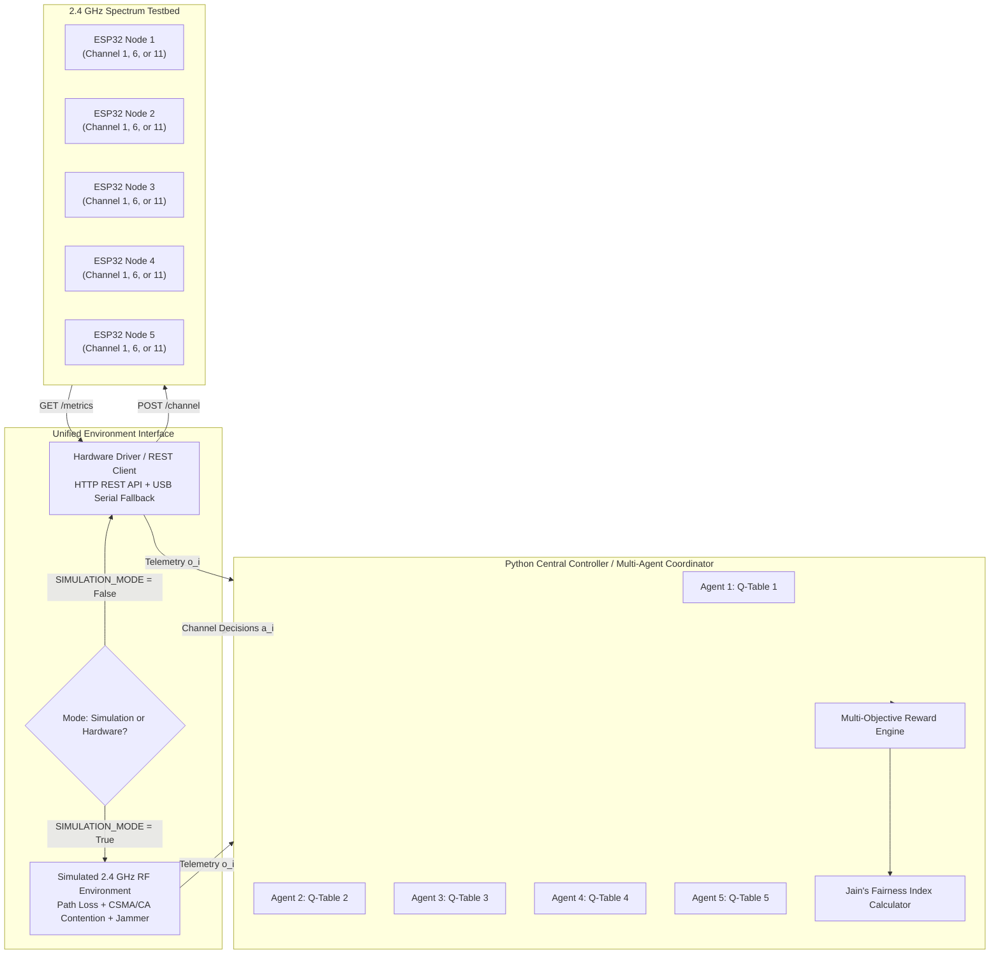

# Dynamic Spectrum Allocation via Multi-Agent Reinforcement Learning (MARL)

## Technical Architecture & Mathematical Implementation Report

---

### 1. Executive Summary

This research project presents an autonomous **Dynamic Spectrum Allocation (DSA)** testbed utilizing **Multi-Agent Reinforcement Learning (MARL)**. Operating over the crowded 2.4 GHz Industrial, Scientific, and Medical (ISM) band, multiple wireless nodes (implemented as ESP32 microcontrollers and high-fidelity synthetic agents) cooperatively optimize spectrum utilization across non-overlapping 802.11 channels (1, 6, and 11).

By coupling local spectrum measurements (RSSI, ambient interference, packet latency, and transmission loss) with an **Independent Q-Learning (IQL)** coordination framework, the system actively avoids congested channels, mitigates contention collisions, dynamically evades external interference (e.g. microwave bursts), and maximizes aggregate network throughput while enforcing strict **Jain's Fairness**.

---

### 2. Theoretical Problem Formulation

#### 2.1 Dec-POMDP Representation
Dynamic spectrum sharing among uncoordinated distributed devices is modeled as a **Decentralized Partially Observable Markov Decision Process (Dec-POMDP)** defined by the tuple:
$$\langle \mathcal{N}, \mathcal{S}, \{\mathcal{A}_i\}, \mathcal{P}, \{R_i\}, \{\Omega_i\}, \mathcal{O}, \gamma \rangle$$

- **Agents ($\mathcal{N}$)**: $\mathcal{N} = \{1, 2, \dots, N\}$, where $N = 5$.
- **Action Space ($\mathcal{A}_i$)**: Each agent selects an orthogonal 2.4 GHz Wi-Fi channel:
  $$\mathcal{A}_i = \{0 \rightarrow \text{Ch 1 (2412 MHz)}, 1 \rightarrow \text{Ch 6 (2437 MHz)}, 2 \rightarrow \text{Ch 11 (2462 MHz)}\}$$
- **Observation Space ($\Omega_i$)**: Agent $i$ cannot observe the complete internal state of all other agents directly. Instead, agent $i$ observes a local feature vector:
  $$\mathbf{o}_i = \langle c_i, \text{RSSI}_i, I_i, T_i, D_i, L_i, \lambda_i \rangle$$
  where $c_i$ is the currently tuned channel, $\text{RSSI}_i$ is received signal strength, $I_i$ is interference power, $T_i$ is throughput, $D_i$ is delay, $L_i$ is packet loss, and $\lambda_i$ is offered traffic demand.
- **State Discretization**: For tabular reinforcement learning, the continuous observation $\mathbf{o}_i$ is mapped to a discrete state tuple:
  $$s_i = (c_{\text{idx}}, \text{rssi}_{\text{bin}}, \text{interf}_{\text{bin}}, \text{traffic}_{\text{bin}})$$
  yielding a compact and rapidly converging state space of $3 \times 3 \times 3 \times 2 = 54$ states per agent.

---

### 3. Multi-Objective Reward Function & Fairness

To prevent selfish spectrum hogging and penalize collisions, the scalar reward $r_i$ balances five objectives:

$$r_i = w_{\text{tp}} \cdot \tilde{T}_i - w_{\text{delay}} \cdot \tilde{D}_i - w_{\text{loss}} \cdot \tilde{L}_i - w_{\text{interf}} \cdot \tilde{I}_i + w_{\text{fair}} \cdot J(\mathbf{T})$$

#### Normalization Functions
$$\tilde{T}_i = \text{clip}\left(\frac{T_i}{T_{\max}}, 0, 1\right), \quad \tilde{D}_i = \text{clip}\left(\frac{D_i}{D_{\max}}, 0, 1\right), \quad \tilde{L}_i = \frac{L_i}{100}, \quad \tilde{I}_i = \text{clip}\left(\frac{I_i - P_{\text{noise}}}{I_{\max}}, 0, 1\right)$$

#### Jain's Fairness Index
To guarantee equitable spectrum allocation across all active nodes, **Jain's Fairness Index** is computed across the instantaneous throughput vector $\mathbf{T} = [T_1, T_2, \dots, T_N]$:

$$J(T_1, T_2, \dots, T_N) = \frac{\left( \sum_{i=1}^N T_i \right)^2}{N \cdot \sum_{i=1}^N T_i^2}$$

- **Upper Bound**: $J = 1.0$ indicates perfectly egalitarian throughput distribution.
- **Lower Bound**: $J = 1/N = 0.20$ occurs when a single node monopolizes the spectrum while all other nodes suffer complete starvation.

---

### 4. Independent Q-Learning (IQL) Mechanics

Each agent maintains an independent action-value function $Q_i(s_i, a_i)$. In contrast to centralized joint-action architectures, IQL scales with complexity $\mathcal{O}(N \cdot |\mathcal{S}| \cdot |\mathcal{A}|)$ rather than $\mathcal{O}(|\mathcal{S}|^N \cdot |\mathcal{A}|^N)$, making it ideal for distributed microcontrollers and edge gateways.

#### Bellman Temporal Difference (TD) Equation
At step $t$, upon observing state $s_t$, executing action $a_t$, receiving reward $r_{t}$, and transitioning to state $s_{t+1}$, the Q-value is updated:

$$Q_i(s_t, a_t) \leftarrow Q_i(s_t, a_t) + \alpha \cdot \delta_t$$

where the Temporal Difference error $\delta_t$ is:
$$\delta_t = \left[ r_{t} + \gamma \max_{a' \in \mathcal{A}_i} Q_i(s_{t+1}, a') \right] - Q_i(s_t, a_t)$$

- $\alpha = 0.1$: Learning rate controlling step size.
- $\gamma = 0.9$: Discount factor valuing future spectral stability.

#### Exploration Schedule ($\epsilon$-Greedy)
Action selection follows:
$$a_i = \begin{cases} \text{UniformRandom}(\mathcal{A}_i), & \text{with probability } \epsilon \\ \arg\max_{a} Q_i(s_i, a), & \text{with probability } 1 - \epsilon \end{cases}$$

$$\epsilon_{k+1} = \max(\epsilon_{\min}, \epsilon_k \cdot \lambda_{\text{decay}})$$
with $\epsilon_{\text{start}} = 1.0$, $\epsilon_{\min} = 0.05$, and $\lambda_{\text{decay}} = 0.995$.

---

### 5. 2.4 GHz Physical Layer & MAC Contention Modeling

#### 5.1 802.11 Spectral Overlap & Orthogonality
In the 2.4 GHz band (2400–2483.5 MHz), channels are spaced at 5 MHz intervals, but each standard 802.11 transmission occupies 20 MHz (or 22 MHz in 802.11b). Consequently, only **Channels 1 (2412 MHz), 6 (2437 MHz), and 11 (2462 MHz)** are mutually orthogonal with greater than 40 dB inter-channel spectral isolation.

#### 5.2 CSMA/CA Contention Overhead
When $k_c$ nodes simultaneously transmit on channel $c$, IEEE 802.11 Distributed Coordination Function (DCF) introduces exponential backoff:
1. When $k_c = 1$: The node experiences zero contention, achieving near-peak throughput ($>20$ Mbps) and minimal latency ($<6$ ms).
2. When $k_c > 1$: Collision probability scales as $P_{\text{coll}} = 1 - (1 - \tau)^{k_c - 1}$. The aggregate throughput degrades:
   $$T_i \approx \frac{C_{\text{channel}}}{k_c^{1 + \beta_{\text{pen}}}}$$
   leading to increased queueing latency and retransmission drops.

#### 5.3 Dynamic External Interference (Jamming)
A synthetic non-cooperative emitter (simulating a microwave oven or legacy uncoordinated AP) injects $+18$ dB of RF power on Channel 6 between time steps 15 and 35. This forces agents on Channel 6 to suffer severe packet loss ($>35\%$), demonstrating the MARL agent's dynamic policy adaptation.

---

### 6. Hardware Networking Realities & Safe Operating Topology

#### The Station-Mode Constraint
In 802.11 Wi-Fi networks, a station (STA) client connected to an Access Point (AP) has its physical radio frequency slaved to the beacon channel of the AP. A single standard Wi-Fi router cannot operate on multiple primary channels simultaneously for independent client stations.

#### Supported Real-World Architectures:
1. **Multi-BSSID / Multi-AP Testbed**: 3 cheap Wi-Fi routers (or 3 ESP32s configured in SoftAP mode) broadcasting on Channels 1, 6, and 11. When an agent decides to switch channels, it roams to the corresponding AP.
2. **ESP-NOW / Peer-to-Peer Mode**: ESP32s communicate directly over raw 802.11 action frames using `esp_wifi_set_channel()`, completely decoupling nodes from commercial AP constraints.
3. **Spectrum Sensing Mode**: Nodes remain connected to a management network while utilizing background Wi-Fi scanning (`WiFi.scanNetworks`) to monitor ambient power across all channels.

---

### 7. Future Upgrades to Advanced MARL Algorithms

The codebase is structured to facilitate straightforward extensions to:
- **Deep Q-Networks (DQN)**: Replace the tabular representation in `marl_agent.py` with a PyTorch multilayer perceptron (`QNetwork(in_dim=7, out_dim=3)`) and an experience replay memory.
- **MADDPG (Multi-Agent Deep Deterministic Policy Gradient)**: Centralized training with decentralized execution (CTDE), enabling continuous power-level control alongside channel selection.
- **QMIX**: Monotonic value factorization guaranteeing that individual greedy actions maximize the joint global action-value function.
